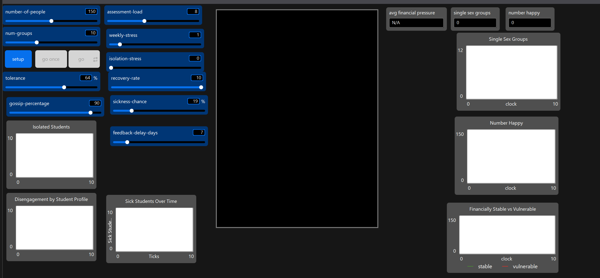
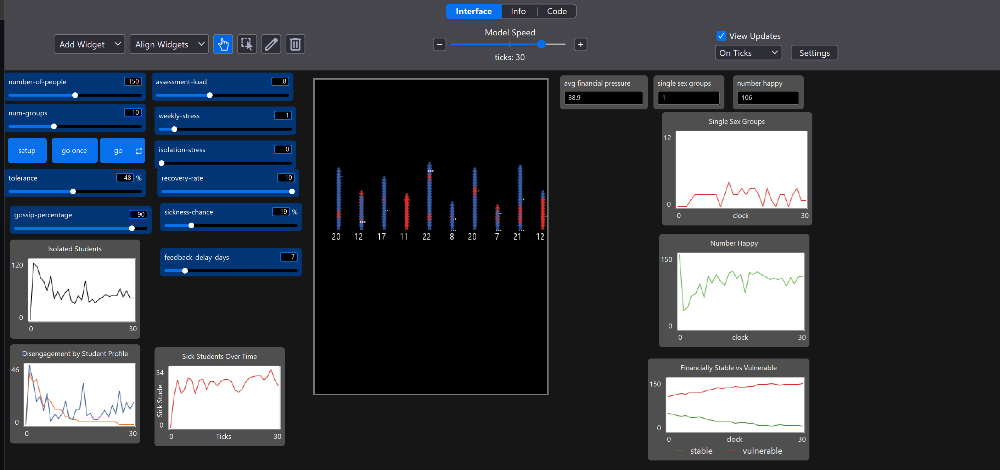

# Digital Twin: Student Lifecycle Agent-Based Model

**University of Liverpool | Micro-Internship Project | Team Lead**

## Overview
This project is a stochastic Agent-Based Model (ABM) built in NetLogo that simulates the psychological, academic, and financial dynamics of a university student lifecycle. Originally branching from a basic 'Party' model, the system was heavily heavily modified by a 5-person team to incorporate dynamic state machines, quadratic administrative friction, and randomized environmental stressors. 

As the Team Lead and System Integrator, I was responsible for architecting the main simulation loop and merging distinct isolated modules into a single program.

## System Architecture & Modules
The simulation evaluates student "happiness" (retention/engagement) as a strict boolean requirement requiring three simultaneous conditions: social integration, emotional stability, and financial solvency. 

The environment integrates four independent stochastic modules:
* **Emotional Reserve (Dynamic Resilience):** Students have a base tolerance that depletes via weekly baseline stress and social isolation, but regenerates when happily integrated.
* **Quadratic Feedback Delay:** Simulates administrative friction. When students wait for assignment feedback, the psychological penalty is zero for the first 7 days, increases linearly up to day 21, and accelerates quadratically thereafter, forcing rapid burnout.
* **Financial Pressure:** A stochastic variable modeling living expenses against random financial support injections. Students falling below critical thresholds are marked as financially vulnerable.
* **Sickness:** A randomized mechanism where students can contract illnesses (visualized as red nodes), which temporarily drains emotional reserves and enforces a strict 2-tick (2-week) recovery cooldown.

## Dashboard & Observability
The GUI features a comprehensive telemetry dashboard tracking macro-behaviors over time:
* **Real-time Population Tracking:** Monitors active vs. isolated students.
* **Financial Stability Matrix:** Plots the ratio of financially stable vs. vulnerable students.
* **Health & Disengagement:** Tracks sickness outbreaks over time and correlates student disengagement against specific demographic risk profiles.

## Visuals

*Figure 1: Main Simulation GUI with dynamic slider constraints and live monitors.*

*Figure 2: Tracking of Financial Stability, Emotional Reserve, and Sickness.*

## Tech Stack
* **Language:** NetLogo (Agent-Based Modeling)
* **Concepts:** Stochastic modeling, Genetic Algorithms (BehaviorSearch calibration), State Machines.
